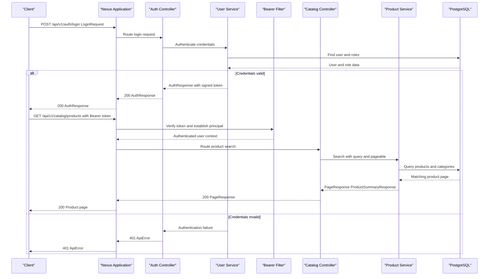

# API & Service Communication Contracts

Backend hiện có 89 HTTP route trong 6 module nghiệp vụ, được host bởi một ứng dụng Spring Boot duy nhất. API dùng REST/JSON đồng bộ; các module không được triển khai hoặc giao tiếp qua HTTP độc lập.

## Service Catalog

| Service / module | Port | Category | Purpose |
|---|---:|---|---|
| `nexus-app` | 8080 | API Layer | Ứng dụng Spring Boot duy nhất, khởi tạo và host toàn bộ controller nghiệp vụ. |
| `nexus-user` | In-process | Business | Đăng ký, đăng nhập, tài khoản, hồ sơ và quản trị người dùng. |
| `nexus-catalog` | In-process | Business | Danh mục, sản phẩm và đánh giá sản phẩm. |
| `nexus-commerce` | In-process | Business | Giỏ hàng, checkout, đơn hàng, thanh toán, campaign và discount code. |
| `nexus-fulfillment` | In-process | Business | SKU, tồn kho, warehouse và vận chuyển. |
| `nexus-auction` | In-process | Business | Phiên đấu giá, bid và settlement. |
| `nexus-notification` | In-process | Business | Tạo và quản lý thông báo người dùng. |
| `nexus-common` | In-process | Infrastructure / shared | Security, API error, pagination và cấu hình dùng chung. |
| PostgreSQL (Docker Compose) | 5432 | Infrastructure | Cơ sở dữ liệu cho ứng dụng; không phải service HTTP. |

`nexus-app` phụ thuộc vào sáu module nghiệp vụ; Docker Compose chỉ khai báo một container ứng dụng và PostgreSQL. Không có port riêng, gateway, service discovery hoặc deployment độc lập cho từng module.

## API Endpoints Inventory

Tất cả route có prefix `/api/v1`. Danh sách dưới đây bao gồm toàn bộ 89 mapping, nhóm theo controller. Tên DTO được liệt kê ở phần **DTOs & Contracts**.

| Service / controller | Method và path | Request / response chính |
|---|---|---|
| User — Auth | `POST /api/v1/auth/register`; `POST /api/v1/auth/login`; `POST /api/v1/auth/logout`; `GET /api/v1/auth/me` | `RegisterRequest` → `UserResponse`; `LoginRequest` → `AuthResponse`; logout không body → `204`; `/me` → `UserResponse`. |
| User — Buyer profile | `GET /api/v1/buyer/profile`; `PUT /api/v1/buyer/profile` | `UpdateProfileRequest` → `ProfileResponse`; GET trả `ProfileResponse`. |
| User — Seller profile | `GET /api/v1/seller/profile`; `PUT /api/v1/seller/profile` | `UpdateProfileRequest` → `ProfileResponse`; GET trả `ProfileResponse`. |
| User — Admin users | `GET /api/v1/admin/users`; `GET /api/v1/admin/users/{id}`; `PATCH /api/v1/admin/users/{id}/status` | Query `keyword`, `status`, `role`, `page`, `size`, `sort`; lần lượt trả `PageResponse<AdminUserSummaryResponse>`, `AdminUserResponse`; PATCH nhận `UpdateUserStatusRequest`. |
| Catalog — Query | `GET /api/v1/catalog/products`; `GET /api/v1/catalog/products/{id}`; `GET /api/v1/catalog/categories`; `GET /api/v1/catalog/products/{id}/reviews` | Query sản phẩm gồm `keyword`, `categoryId`, `minPrice`, `maxPrice`, `status` và pageable; trả `PageResponse<ProductSummaryResponse>`, `ProductResponse`, `List<CategoryResponse>`, `PageResponse<ReviewResponse>`. |
| Catalog — Seller products | `POST /api/v1/seller/catalog/products`; `PUT /api/v1/seller/catalog/products/{id}`; `DELETE /api/v1/seller/catalog/products/{id}`; `PATCH /api/v1/seller/catalog/products/{id}/category` | Nhận lần lượt `CreateProductRequest`, `UpdateProductRequest`, `AssignCategoryRequest`; trả `ProductResponse` khi có body; DELETE trả `204`. |
| Catalog — Buyer reviews | `POST /api/v1/buyer/catalog/products/{id}/reviews` | Nhận `CreateReviewRequest`; trả `ReviewResponse`. |
| Catalog — Admin | `GET /api/v1/admin/catalog/categories`; `GET /api/v1/admin/catalog/categories/{id}`; `POST /api/v1/admin/catalog/categories`; `PUT /api/v1/admin/catalog/categories/{id}`; `DELETE /api/v1/admin/catalog/categories/{id}`; `GET /api/v1/admin/catalog/products`; `PATCH /api/v1/admin/catalog/products/{id}/status`; `DELETE /api/v1/admin/catalog/products/{id}`; `GET /api/v1/admin/catalog/reviews`; `PATCH /api/v1/admin/catalog/reviews/{id}/status` | Category CRUD dùng `CreateCategoryRequest` / `UpdateCategoryRequest`; status mutations dùng `UpdateProductStatusRequest` / `UpdateReviewStatusRequest`. Danh sách trả các `PageResponse` theo resource; tạo trả `201`, xóa trả `204`. |
| Commerce — Buyer | `GET /api/v1/buyer/commerce/cart`; `POST /api/v1/buyer/commerce/cart/items`; `PUT /api/v1/buyer/commerce/cart/items/{itemId}`; `DELETE /api/v1/buyer/commerce/cart/items/{itemId}`; `POST /api/v1/buyer/commerce/checkout`; `POST /api/v1/buyer/commerce/checkout/apply-discount`; `GET /api/v1/buyer/commerce/orders`; `GET /api/v1/buyer/commerce/orders/{id}`; `POST /api/v1/buyer/commerce/orders/{id}/cancel`; `POST /api/v1/buyer/commerce/orders/{id}/payments`; `POST /api/v1/buyer/commerce/payments/{id}/confirm`; `POST /api/v1/buyer/commerce/seller-ratings` | Cart inputs: `AddCartItemRequest`, `UpdateCartItemRequest`; checkout/discount: `CheckoutRequest`, `ApplyDiscountRequest`; payment: `CreatePaymentRequest`, `ConfirmPaymentRequest`; rating: `CreateSellerRatingRequest`. Outputs include `CartResponse`, `ApplyDiscountResponse`, `OrderResponse` / `OrderSummaryResponse`, `PaymentResponse`, `SellerRatingResponse`. |
| Commerce — Seller | `GET /api/v1/seller/commerce/orders`; `GET /api/v1/seller/commerce/orders/{id}`; `PATCH /api/v1/seller/commerce/orders/{id}/status`; `POST /api/v1/seller/commerce/orders/{id}/cancel` | Query `status` và pageable; status mutation nhận `UpdateOrderStatusRequest`; trả order response/summary. |
| Commerce — Admin | `GET /api/v1/admin/commerce/orders`; `GET /api/v1/admin/commerce/orders/{id}`; `PATCH /api/v1/admin/commerce/orders/{id}/status`; `POST /api/v1/admin/commerce/orders/{id}/cancel`; `GET /api/v1/admin/commerce/campaigns`; `GET /api/v1/admin/commerce/campaigns/{id}`; `POST /api/v1/admin/commerce/campaigns`; `PUT /api/v1/admin/commerce/campaigns/{id}`; `DELETE /api/v1/admin/commerce/campaigns/{id}`; `GET /api/v1/admin/commerce/discount-codes`; `GET /api/v1/admin/commerce/discount-codes/{id}`; `POST /api/v1/admin/commerce/discount-codes`; `PUT /api/v1/admin/commerce/discount-codes/{id}`; `PATCH /api/v1/admin/commerce/discount-codes/{id}/status` | Order query lọc `buyerId`, `sellerId`, `status`; campaign nhận `CreateCampaignRequest` / `UpdateCampaignRequest`; discount code nhận `CreateDiscountCodeRequest`, `UpdateDiscountCodeRequest`, `UpdateDiscountCodeStatusRequest`. |
| Fulfillment — Seller | `POST /api/v1/seller/fulfillment/skus`; `GET /api/v1/seller/fulfillment/skus`; `GET /api/v1/seller/fulfillment/inventories`; `GET /api/v1/seller/fulfillment/inventories/{id}`; `PATCH /api/v1/seller/fulfillment/inventories/{id}`; `POST /api/v1/seller/fulfillment/shipments`; `PATCH /api/v1/seller/fulfillment/shipments/{id}/status` | Request DTOs: `CreateSkuRequest`, `UpdateInventoryRequest`, `CreateShipmentRequest`, `UpdateShipmentStatusRequest`; response DTOs: `SkuResponse`, `InventoryResponse`, `ShipmentResponse`. |
| Fulfillment — Buyer | `GET /api/v1/buyer/fulfillment/shipments` | Required query `orderId`; trả `List<ShipmentResponse>`. |
| Fulfillment — Admin | `GET /api/v1/admin/fulfillment/inventories`; `GET /api/v1/admin/fulfillment/warehouses`; `GET /api/v1/admin/fulfillment/warehouses/{id}`; `POST /api/v1/admin/fulfillment/warehouses`; `PUT /api/v1/admin/fulfillment/warehouses/{id}` | Inventory/warehouse lists hỗ trợ filter và pageable; warehouse mutations nhận `CreateWarehouseRequest` / `UpdateWarehouseRequest`; response DTOs `InventoryResponse`, `WarehouseResponse`. |
| Auction — Query | `GET /api/v1/auction/auctions`; `GET /api/v1/auction/auctions/{id}`; `GET /api/v1/auction/auctions/{id}/bids`; `GET /api/v1/auction/auctions/{id}/settlement` | Query danh sách nhận `status`, `keyword` và pageable; trả `PageResponse<AuctionSummaryResponse>`, `AuctionResponse`, `PageResponse<BidResponse>`, `SettlementResponse`. |
| Auction — Seller | `POST /api/v1/seller/auction/auctions`; `PUT /api/v1/seller/auction/auctions/{id}`; `POST /api/v1/seller/auction/auctions/{id}/cancel` | Create/update nhận `CreateAuctionRequest` / `UpdateAuctionRequest`; response `AuctionResponse`. |
| Auction — Buyer | `POST /api/v1/buyer/auction/auctions/{id}/bids` | Nhận `PlaceBidRequest`; trả `BidResponse`. |
| Auction — Admin | `GET /api/v1/admin/auction/auctions`; `POST /api/v1/admin/auction/auctions/{id}/cancel` | Query nhận `status`, `keyword` và pageable; response `PageResponse<AdminAuctionResponse>` hoặc `AuctionResponse`. |
| Notification — Common | `POST /api/v1/notification/notifications`; `GET /api/v1/notification/notifications`; `GET /api/v1/notification/notifications/unread-count`; `GET /api/v1/notification/notifications/{id}`; `PATCH /api/v1/notification/notifications/{id}/read`; `PATCH /api/v1/notification/notifications/read-all` | Create nhận `CreateNotificationRequest`; list query gồm `unreadOnly`, `eventType` và pageable; response `NotificationResponse`, `PageResponse<NotificationSummaryResponse>`, `long`, `MarkAllReadResponse`. |

Các list có `Pageable` dùng query chuẩn Spring Data `page`, `size`, `sort`. Contract pagination thống nhất là `PageResponse<T>` với `content`, `page`, `size`, `totalElements`, `totalPages`, `first`, `last`.

## Management & Observability Endpoints

| Service | Endpoint | Custom metrics |
|---|---|---|
| `nexus-app` | `GET /actuator/health` | Không thấy custom metric. |
| `nexus-app` | `GET /actuator/info` | Không thấy custom metric. |
| `nexus-app` | `GET /actuator/metrics` | Spring Actuator metrics endpoint được expose; không thấy custom metric. |
| `nexus-app` | `GET /v3/api-docs` | OpenAPI JSON do Springdoc sinh từ source. |
| `nexus-app` | `/swagger-ui.html`, `/swagger-ui/**` | Swagger UI. |

Không thấy cấu hình expose `/actuator/prometheus`. Health/info và tài liệu OpenAPI được mở công khai; metrics cần xác thực theo security matcher hiện tại.

## DTOs & Contracts

Các API request/response sử dụng Java `record`, do đó immutable. Không thấy DTO tầng gateway/aggregation; DTO thuộc module nghiệp vụ tương ứng. Entity nội bộ không liệt kê ở đây; cấu hình JSON dùng Jackson và loại bỏ thuộc tính null (`default-property-inclusion: non_null`).

- **User:** Request — `RegisterRequest`, `LoginRequest`, `UpdateProfileRequest`, `UpdateUserStatusRequest`. Response — `UserResponse`, `AuthResponse`, `ProfileResponse`, `AdminUserResponse`, `AdminUserSummaryResponse`.
- **Catalog:** Request — `CreateCategoryRequest`, `UpdateCategoryRequest`, `UpdateProductStatusRequest`, `UpdateReviewStatusRequest`, `CreateReviewRequest`, `AssignCategoryRequest`, `CreateProductRequest`, `ProductImageRequest`, `UpdateProductRequest`. Response — `CategoryResponse`, `ProductResponse`, `ProductSummaryResponse`, `ReviewResponse`.
- **Commerce:** Request — `CreateCampaignRequest`, `UpdateCampaignRequest`, `CreateDiscountCodeRequest`, `UpdateDiscountCodeRequest`, `UpdateDiscountCodeStatusRequest`, `AddCartItemRequest`, `UpdateCartItemRequest`, `ApplyDiscountRequest`, `CheckoutRequest`, `ConfirmPaymentRequest`, `CreatePaymentRequest`, `CreateSellerRatingRequest`, `UpdateOrderStatusRequest`. Response — `CampaignResponse`, `DiscountCodeResponse`, `ApplyDiscountResponse`, `CartItemResponse`, `CartResponse`, `OrderItemResponse`, `OrderResponse`, `OrderSummaryResponse`, `PaymentResponse`, `SellerRatingResponse`.
- **Fulfillment:** Request — `CreateWarehouseRequest`, `UpdateWarehouseRequest`, `CreateShipmentRequest`, `CreateSkuRequest`, `UpdateInventoryRequest`, `UpdateShipmentStatusRequest`. Response — `InventoryResponse`, `ShipmentResponse`, `SkuResponse`, `WarehouseResponse`.
- **Auction:** Request — `PlaceBidRequest`, `CreateAuctionRequest`, `UpdateAuctionRequest`. Response — `AdminAuctionResponse`, `AuctionResponse`, `AuctionSummaryResponse`, `BidResponse`, `SettlementResponse`.
- **Notification:** Request — `CreateNotificationRequest`. Response — `MarkAllReadResponse`, `NotificationResponse`, `NotificationSummaryResponse`.
- **Shared:** `PageResponse<T>` là wrapper pagination; `ApiError` và `ApiError.FieldViolation` định nghĩa lỗi dùng chung.

Có OpenAPI runtime qua Springdoc (`/v3/api-docs`) và Swagger UI; chưa thấy file OpenAPI tĩnh trong repo.

## Communication Patterns

- **API/intra-application:** HTTP REST/JSON đồng bộ qua Spring MVC. Luồng nội bộ là controller → service → repository; các module nghiệp vụ được đóng gói cùng ứng dụng và không phát hiện client REST/gRPC để gọi lẫn nhau.
- **Async:** Không thấy message broker, event bus hoặc pub/sub. Auction có scheduler chuyển trạng thái định kỳ; chu kỳ mặc định 15.000 ms.
- **Resilience/discovery/gateway:** Không thấy retry, circuit breaker, timeout policy ở tầng service, service discovery, client-side load balancing hoặc API gateway.
- **Data:** Ứng dụng kết nối PostgreSQL; module chia theo nghiệp vụ trong cùng runtime và không phải service độc lập.
- **AuthN/AuthZ:** Stateless bearer token. Implementation hiện tại là token nội bộ ký HMAC-SHA256 có thời hạn (mặc định 480 phút), không phải JWT chuẩn dù OpenAPI mô tả bearer scheme. Chỉ `POST /api/v1/auth/register` và `POST /api/v1/auth/login` được `permitAll`; logout, `/me`, các route nghiệp vụ cần xác thực. Controller áp dụng `@PreAuthorize` theo BUYER/SELLER/ADMIN hoặc `isAuthenticated()`.
- **Logout:** API trả `204`; do xác thực stateless, client có trách nhiệm xóa token. Không có token revocation phía server.
- **TLS/CORS:** Không thấy cấu hình TLS trong ứng dụng/Compose; nếu cần HTTPS phải được cấu hình ở tầng triển khai/proxy. CORS mặc định cho phép localhost:3000 và localhost:5173, methods GET/POST/PUT/PATCH/DELETE/OPTIONS; origins có thể cấu hình qua biến môi trường.
- **Lỗi:** Response lỗi có cấu trúc `ApiError(timestamp, status, error, message, path, details)`. Các mã chính gồm `400` (`VALIDATION_ERROR`, `BAD_REQUEST`), `401`, `403`, `404`, `409`, `422` (`BUSINESS_RULE_VIOLATION`) và `500`.

## Service Technology Matrix

| Service / module | Web | Data access | Discovery | Gateway | Actuator | Cache | Metrics |
|---|---|---|---|---|---|---|---|
| `nexus-app` | Spring MVC | Spring Data JPA / Hibernate | None | None | Health, info, metrics | None found | Actuator metrics |
| `nexus-user` | Spring MVC, in-process | Spring Data JPA | None | None | Hosted by `nexus-app` | None found | Hosted by `nexus-app` |
| `nexus-catalog` | Spring MVC, in-process | Spring Data JPA | None | None | Hosted by `nexus-app` | None found | Hosted by `nexus-app` |
| `nexus-commerce` | Spring MVC, in-process | Spring Data JPA | None | None | Hosted by `nexus-app` | None found | Hosted by `nexus-app` |
| `nexus-fulfillment` | Spring MVC, in-process | Spring Data JPA | None | None | Hosted by `nexus-app` | None found | Hosted by `nexus-app` |
| `nexus-auction` | Spring MVC, in-process | Spring Data JPA | None | None | Hosted by `nexus-app` | None found | Hosted by `nexus-app` |
| `nexus-notification` | Spring MVC, in-process | Spring Data JPA | None | None | Hosted by `nexus-app` | None found | Hosted by `nexus-app` |

## Service Communication Sequence

Ví dụ luồng login lấy bearer token, sau đó gọi API tra cứu catalog; các thành phần nghiệp vụ chạy trong cùng process và truy cập PostgreSQL trực tiếp qua repository.

<!-- mermaid-checked: every participant uses `participant Id as "Label"`, no \n in aliases/messages/notes, every alt/opt/loop closed by end, no `:` inside any alias -->

