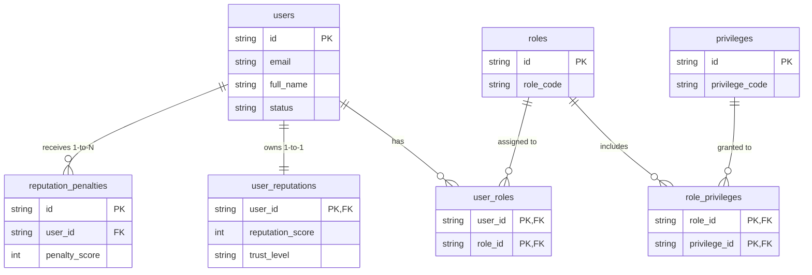
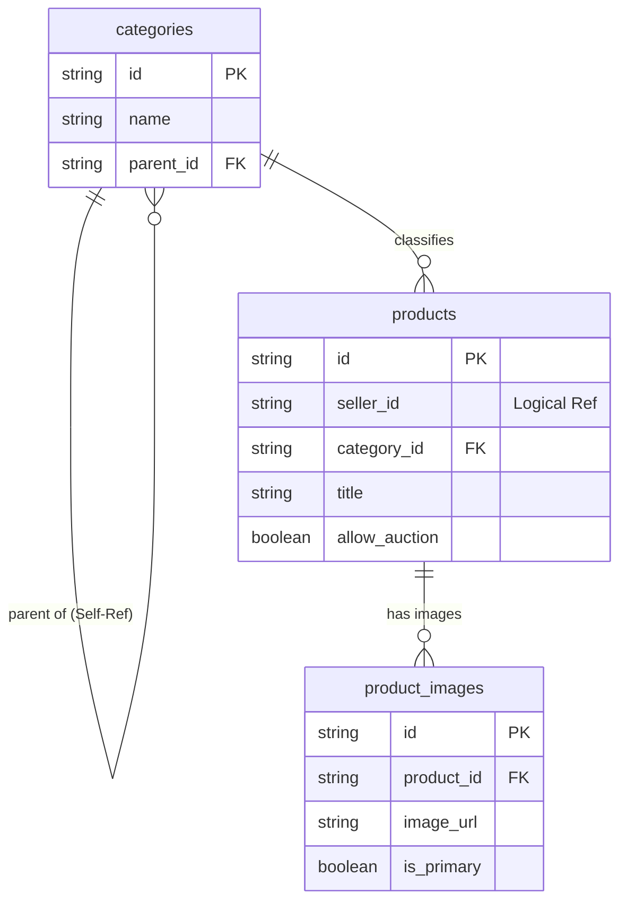
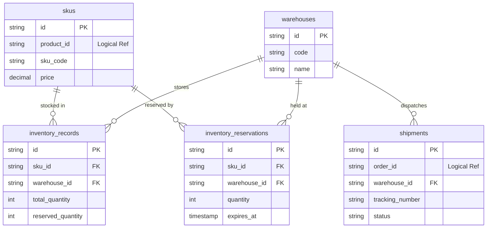
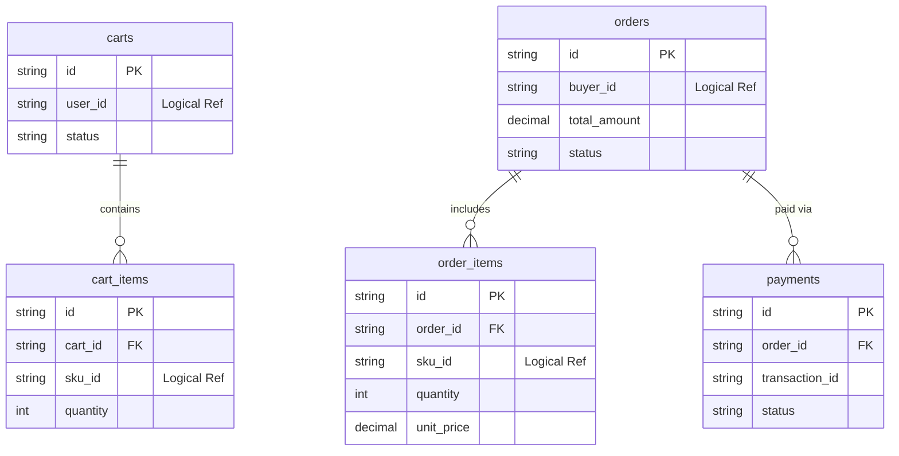
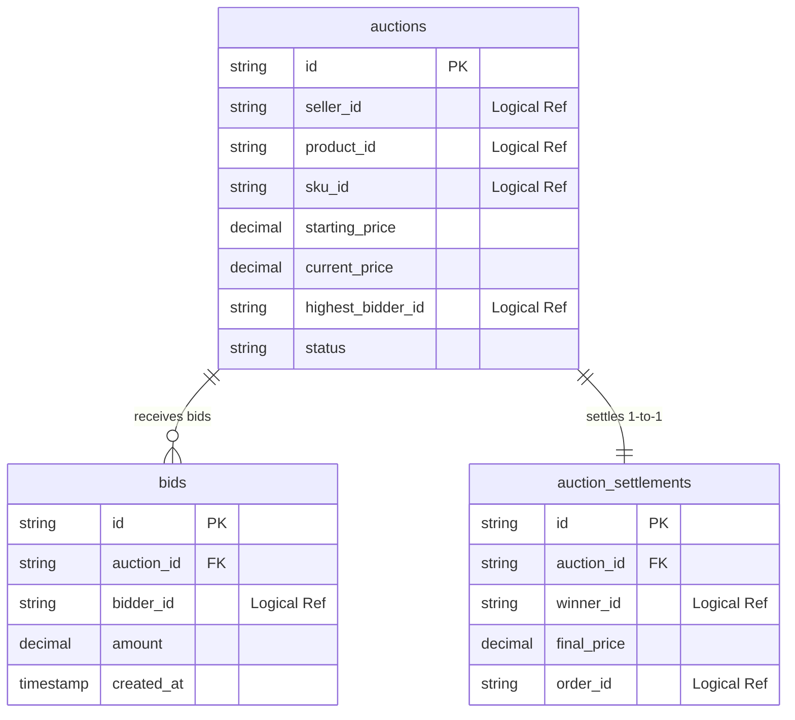

# THIẾT KẾ CƠ SỞ DỮ LIỆU SQL TOÀN DIỆN: PROJECT NEXUS

> **Dành cho Đồ án & Hệ thống E-Commerce Auction Microservices**  
> *Mục tiêu:* Cung cấp toàn bộ thiết kế Thực thể (Tables), Thuộc tính (Columns), Mối quan hệ (ERD Diagram), Script SQL CREATE TABLE và giải thích dân dã "như cho người chưa biết gì cũng hiểu".

---

## 1. NGUYÊN TẮC QUAN TRỌNG VỀ CƠ SỞ DỮ LIỆU MICROSERVICES

Trước khi vào chi tiết từng bảng, hãy ghi nhớ 2 nguyên tắc vàng này để không bị thầy cô trừ điểm:

1. **Database-per-Service (Mỗi dịch vụ có sổ tay riêng):**
   - 6 Microservices sẽ có 6 Cơ sở dữ liệu (hoặc 6 Schemas) tách biệt hoàn toàn.
   - Không được dùng Khóa ngoại (Foreign Key - FK) nối trực tiếp giữa DB của dịch vụ này với DB của dịch vụ khác.
2. **Hai loại Mối quan hệ trong hệ thống:**
   - **Khóa ngoại cứng (Hard FK):** Nối các bảng TRONG CÙNG 1 Microservice (VD: `orders` nối với `order_items`).
   - **Tham chiếu logic (Logical Reference):** Chỉ lưu ID dạng chuỗi/số để tham chiếu SANG Microservice khác (VD: Bảng `orders` của Commerce Service chỉ lưu cột `buyer_id` dạng String, chứ KHÔNG làm FK nối sang bảng `users` của User Service).

---

## 2. SƠ ĐỒ MỐI QUAN HỆ TỔNG THỂ (OVERALL ERD DIAGRAM) & PHÂN RÃ

### 2.1 Sơ đồ ERD Liên Dịch Vụ Tổng Thể (Overall System Logical ERD)

```mermaid
erDiagram
    %% USER & REPUTATION SERVICE
    USERS ||--o{ USER_ROLES : "gán"
    ROLES ||--o{ USER_ROLES : "thuộc"
    ROLES ||--o{ ROLE_PRIVILEGES : "chứa"
    PRIVILEGES ||--o{ ROLE_PRIVILEGES : "thuộc"
    USERS ||--|| USER_REPUTATIONS : "sở hữu (1-1)"
    USERS ||--o{ REPUTATION_PENALTIES : "bị phạt (1-N)"

    %% CATALOG SERVICE
    CATEGORIES ||--o{ CATEGORIES : "danh mục cha (Recursive)"
    CATEGORIES ||--o{ PRODUCTS : "chứa (1-N)"
    PRODUCTS ||--o{ PRODUCT_IMAGES : "có ảnh (1-N)"

    %% FULFILLMENT SERVICE
    SKUS ||--o{ INVENTORY_RECORDS : "tồn kho (N-N via record)"
    WAREHOUSES ||--o{ INVENTORY_RECORDS : "lưu tại"
    SKUS ||--o{ INVENTORY_RESERVED : "giữ tạm (1-N)"
    WAREHOUSES ||--o{ SHIPMENTS : "xuất kho (1-N)"

    %% COMMERCE SERVICE
    CARTS ||--o{ CART_ITEMS : "chứa (1-N)"
    ORDERS ||--o{ ORDER_ITEMS : "gồm (1-N)"
    ORDERS ||--o{ PAYMENTS : "thanh toán (1-N)"

    %% AUCTION SERVICE
    AUCTIONS ||--o{ BIDS : "nhận giá (1-N)"
    AUCTIONS ||--|| AUCTION_SETTLEMENTS : "chốt kết quả (1-1)"

    %% LOGICAL CROSS-SERVICE REFERENCES (Liên kết Logic giữa các Service)
    USERS ..o{ PRODUCTS : "seller_id (Logical)"
    PRODUCTS ..o{ SKUS : "product_id (Logical)"
    USERS ..|| CARTS : "user_id (Logical)"
    SKUS ..o{ CART_ITEMS : "sku_id (Logical)"
    USERS ..o{ ORDERS : "buyer_id (Logical)"
    SKUS ..o{ ORDER_ITEMS : "sku_id (Logical)"
    ORDERS ..|| SHIPMENTS : "order_id (Logical)"
    USERS ..o{ AUCTIONS : "seller_id / highest_bidder_id (Logical)"
    SKUS ..o{ AUCTIONS : "sku_id (Logical)"
    AUCTION_SETTLEMENTS ..|| ORDERS : "order_id (Logical)"
    USERS ..o{ NOTIFICATIONS : "user_id (Logical)"
```

---

### 2.2 Sơ đồ ERD Phân Rã Chi Tiết Từng Microservice

#### A. ERD User & Reputation Service


#### B. ERD Catalog Service


#### C. ERD Fulfillment Service


#### D. ERD Commerce Service


#### E. ERD Auction Service


---

## 2.5 HỆ THỐNG HÓA TẤT CẢ MỐI QUAN HỆ (RELATIONSHIP MATRIX)

### 2.5.1 Bảng Tổng Hợp Mối Quan Hệ Trong Hệ Thống

| STT | Thực thể A | Loại Quan Hệ | Thực thể B | Loại Liên Kết | Trường Liên Kết (Key) | Ý Nghĩa & Cách Hoạt Động ("Thế Nào") |
|:---|:---|:---:|:---|:---:|:---|:---|
| **1** | `users` | **1 — N** | `user_roles` | **Hard FK** | `user_roles.user_id -> users.id` | 1 User sở hữu nhiều role trong bảng nối n-n. `ON DELETE CASCADE` xóa bớt role khi xoá user. |
| **2** | `roles` | **1 — N** | `user_roles` | **Hard FK** | `user_roles.role_id -> roles.id` | 1 Role được gán cho nhiều User. |
| **3** | `roles` | **1 — N** | `role_privileges` | **Hard FK** | `role_privileges.role_id -> roles.id` | 1 Role phân tách thành nhiều Privilege chi tiết (RBAC). |
| **4** | `privileges` | **1 — N** | `role_privileges` | **Hard FK** | `role_privileges.privilege_id -> privileges.id` | 1 Privilege thuộc về nhiều Role khác nhau. |
| **5** | `users` | **1 — 1** | `user_reputations` | **Hard FK** | `user_reputations.user_id -> users.id` | Quản lý điểm uy tín 1:1. `user_id` vừa là PK vừa là FK nối sang `users`. |
| **6** | `users` | **1 — N** | `reputation_penalties` | **Hard FK** | `reputation_penalties.user_id -> users.id` | 1 User có thể bị phạt trừ điểm uy tín nhiều lần (lưu lịch sử phạt). |
| **7** | `categories` | **1 — N** | `categories` | **Hard FK (Self-Ref)** | `categories.parent_id -> categories.id` | **Tự tham chiếu (Recursive)**: Danh mục cha - con đa cấp (tối đa 3 cấp). `ON DELETE SET NULL`. |
| **8** | `categories` | **1 — N** | `products` | **Hard FK** | `products.category_id -> categories.id` | 1 Danh mục chứa nhiều sản phẩm; 1 sản phẩm gắn đúng 1 danh mục chính. |
| **9** | `products` | **1 — N** | `product_images` | **Hard FK** | `product_images.product_id -> products.id` | 1 Sản phẩm có tối đa 5 hình ảnh minh họa (`is_primary` đánh dấu ảnh đại diện). |
| **10** | `skus` | **1 — N** | `inventory_records` | **Hard FK** | `inventory_records.sku_id -> skus.id` | Nối bảng tồn kho. 1 mã SKU nằm ở nhiều kho. |
| **11** | `warehouses` | **1 — N** | `inventory_records` | **Hard FK** | `inventory_records.warehouse_id -> warehouses.id` | 1 Kho hàng lưu trữ tồn kho cho nhiều mã SKU khác nhau. |
| **12** | `skus` | **1 — N** | `inventory_reservations` | **Hard FK** | `inventory_reservations.sku_id -> skus.id` | Phiếu giữ kho 30 phút. 1 SKU có nhiều đợt giữ kho chờ thanh toán. |
| **13** | `warehouses` | **1 — N** | `inventory_reservations` | **Hard FK** | `inventory_reservations.warehouse_id -> warehouses.id` | Phiếu giữ kho áp dụng tại đúng kho chứa hàng đó. |
| **14** | `warehouses` | **1 — N** | `shipments` | **Hard FK** | `shipments.warehouse_id -> warehouses.id` | Kho hàng xuất nhiều kiện vận chuyển cho đơn vị GHN/GHTK. |
| **15** | `carts` | **1 — N** | `cart_items` | **Hard FK** | `cart_items.cart_id -> carts.id` | 1 Giỏ hàng chứa nhiều item chọn mua. |
| **16** | `orders` | **1 — N** | `order_items` | **Hard FK** | `order_items.order_id -> orders.id` | 1 Đơn hàng gồm nhiều dòng chi tiết sản phẩm hóa đơn. |
| **17** | `orders` | **1 — N** | `payments` | **Hard FK** | `payments.order_id -> orders.id` | 1 Đơn hàng có thể có nhiều bản ghi giao dịch (thử lại thanh toán khi thất bại). |
| **18** | `auctions` | **1 — N** | `bids` | **Hard FK** | `bids.auction_id -> auctions.id` | 1 Phiên đấu giá nhận nhiều lượt đặt giá (bids) của người dùng. |
| **19** | `auctions` | **1 — 1** | `auction_settlements` | **Hard FK** | `auction_settlements.auction_id -> auctions.id` | 1 Phiên đấu giá khi kết thúc có duy nhất 1 biên bản chốt người thắng và đơn hàng. |
| **20** | `users` (User Sv) | **1 — N** | `products` (Catalog Sv) | **Logical Ref** | `products.seller_id = users.id` | Người bán (Seller) đăng sản phẩm. Lưu `seller_id` dạng String (UUID). |
| **21** | `products` (Catalog Sv) | **1 — N** | `skus` (Fulfill Sv) | **Logical Ref** | `skus.product_id = products.id` | 1 Sản phẩm gốc phân rã thành nhiều SKU biến thể (Màu sắc, dung lượng...). |
| **22** | `users` (User Sv) | **1 — 1** | `carts` (Commerce Sv) | **Logical Ref** | `carts.user_id = users.id` | Người mua có 1 giỏ hàng active để mua sắm. |
| **23** | `skus` (Fulfill Sv) | **1 — N** | `cart_items` (Commerce Sv) | **Logical Ref** | `cart_items.sku_id = skus.id` | Item trong giỏ lưu mã SKU định mua. |
| **24** | `users` (User Sv) | **1 — N** | `orders` (Commerce Sv) | **Logical Ref** | `orders.buyer_id = users.id` | Người mua (Buyer) tạo đơn hàng. |
| **25** | `skus` (Fulfill Sv) | **1 — N** | `order_items` (Commerce Sv) | **Logical Ref** | `order_items.sku_id = skus.id` | Đơn hàng mua mã SKU nào kèm Snapshot dữ liệu tên/giá tại thời điểm mua. |
| **26** | `orders` (Commerce Sv) | **1 — 1** | `shipments` (Fulfill Sv) | **Logical Ref** | `shipments.order_id = orders.id` | Đơn hàng kích hoạt 1 vận đơn giao hàng bên Fulfillment Service. |
| **27** | `users` (User Sv) | **1 — N** | `auctions` (Auction Sv) | **Logical Ref** | `auctions.seller_id / highest_bidder_id = users.id` | Lưu vết ai là người mở đấu giá và ai đang trả giá cao nhất. |
| **28** | `skus` (Fulfill Sv) | **1 — N** | `auctions` (Auction Sv) | **Logical Ref** | `auctions.sku_id = skus.id` | Đấu giá cụ thể cho mã SKU nào. |
| **29** | `users` (User Sv) | **1 — N** | `bids` (Auction Sv) | **Logical Ref** | `bids.bidder_id = users.id` | Lưu vết ai vừa giơ bảng trả giá lượt đấu giá đó. |
| **30** | `auction_settlements` | **1 — 1** | `orders` (Commerce Sv) | **Logical Ref** | `auction_settlements.order_id = orders.id` | Chốt đấu giá phát event tự động sinh Đơn hàng bên Commerce Service. |
| **31** | `users` (User Sv) | **1 — N** | `notifications` | **Logical Ref** | `notifications.user_id = users.id` | Thông báo gửi đích danh cho User ID. |

---

### 2.5.2 Phân Loại & Giải Thích Chi Tiết 4 Dạng Mối Quan Hệ

#### 1. Mối quan hệ Một - Nhiều (1 - N / One-to-Many)
- **Cách hoạt động:** Khóa chính (PK) của thực thể bên nhánh `1` được đưa sang làm Khóa ngoại (FK) nằm trong thực thể bên nhánh `N`.
- **Ví dụ tiêu biểu trong bài:** 
  - `orders` (1) — (N) `order_items`: 1 hóa đơn gồm nhiều món hàng. Cột `order_items.order_id` lưu ID của hóa đơn mẹ.
  - `auctions` (1) — (N) `bids`: 1 phòng đấu giá nhận hàng trăm lượt đẩy giá từ khách.

#### 2. Mối quan hệ Nhiều - Nhiều (N - N / Many-to-Many)
- **Cách hoạt động:** Không thể nối trực tiếp giữa 2 bảng vì gây trùng lặp dữ liệu. Bắt buộc phải tạo **Bảng Trung Gian (Junction/Pivot Table)** chứa cặp khóa ngoại `(FK_A, FK_B)`.
- **Ví dụ tiêu biểu trong bài:**
  - `users` (N) — (N) `roles` thông qua bảng trung gian `user_roles (user_id, role_id)`.
  - `roles` (N) — (N) `privileges` thông qua bảng trung gian `role_privileges (role_id, privilege_id)`.
  - `skus` (N) — (N) `warehouses` thông qua bảng trung gian `inventory_records (sku_id, warehouse_id, total_quantity)`.

#### 3. Mối quan hệ Một - Một (1 - 1 / One-to-One)
- **Cách hoạt động:** Hai thực thể liên kết 1-1 với nhau. Khóa chính của thực thể phụ thường được dùng làm luôn Khóa ngoại trỏ về thực thể chính.
- **Ví dụ tiêu biểu trong bài:**
  - `users` (1) — (1) `user_reputations`: Mỗi user chỉ có đúng 1 hồ sơ điểm uy tín. Bảng `user_reputations` dùng `user_id` vừa làm PK vừa làm FK trỏ về `users.id`.
  - `auctions` (1) — (1) `auction_settlements`: Khi gõ búa kết thúc, chỉ có 1 biên bản chốt duy nhất cho phiên đấu giá đó.

#### 4. Mối quan hệ Tự tham chiếu (Recursive / Self-Referencing Relationship)
- **Cách hoạt động:** Khóa ngoại của một bảng trỏ về chính Khóa chính của bảng đó.
- **Ví dụ tiêu biểu trong bài:**
  - `categories.parent_id -> categories.id`: Giúp xây dựng cây danh mục phân cấp không giới hạn (VD: *Đồ điện tử -> Điện thoại -> iPhone*). Danh mục gốc (*Đồ điện tử*) sẽ có `parent_id = NULL`.

---

#### 5. Mối quan hệ Tham chiếu Logic Liên Dịch Vụ (Cross-Service Logical Relationship)
- **Bản chất trong Microservices:** Vì mỗi Microservice sở hữu Cơ sở dữ liệu độc lập (Database-per-service), chúng ta **TUYỆT ĐỐI KHÔNG** khai báo constraint `FOREIGN KEY ... REFERENCES ...` giữa 2 database khác nhau.
- **Cách triển khai:** 
  - Chỉ lưu giá trị UUID (VD: `seller_id VARCHAR(36)`) ở dịch vụ gọi.
  - Khi cần lấy thông tin chi tiết (VD: hiển thị tên người bán trên trang sản phẩm), service sẽ gọi API gRPC/REST hoặc lấy từ Cache (Redis).
  - Khi có sự thay đổi (VD: User bị xóa/khóa tài khoản), User Service sẽ phát ra **Domain Event** (`UserBlockedEvent`) qua Message Broker (Kafka/RabbitMQ) để các Service khác cập nhật trạng thái tương ứng.

---

---

## 3. PHÂN TÍCH CHI TIẾT TỪNG DỊCH VỤ & GIẢI THÍCH "DÂN DÃ"

---

### 3.1 USER & REPUTATION SERVICE (Quản lý Người dùng & Uy tín)

> **Giải thích siêu dễ hiểu:**  
> Giống như sổ quản lý dân cư của phường. Nó ghi lại ai tên là gì, ở đâu, mật khẩu đăng nhập là gì, thuộc quyền hạn nào (Dân thường hay Tổ trưởng) và có ngoan không (Điểm uy tín cao hay bị phạt vì tội bùng hàng).

#### Danh sách bảng & Thuộc tính:

##### Bảng `users` (Danh sách tài khoản)
- `id` (VARCHAR(36), PK): Mã định danh duy nhất (UUID).
- `email` (VARCHAR(255), UNIQUE, NOT NULL): Email đăng nhập.
- `phone_number` (VARCHAR(20)): Số điện thoại.
- `full_name` (VARCHAR(100), NOT NULL): Họ và tên.
- `identify_number` (VARCHAR(20)): Số CCCD/CMND.
- `gender` (VARCHAR(10)): Giới tính (MALE, FEMALE, OTHER).
- `address` (TEXT): Địa chỉ thường trú.
- `date_of_birth` (DATE): Ngày tháng năm sinh.
- `password_hash` (VARCHAR(255), NOT NULL): Mật khẩu đã mã hóa (không lưu mật khẩu thô).
- `status` (VARCHAR(20), DEFAULT 'ACTIVE'): Trạng thái (ACTIVE, BLOCKED, DELETED).
- `created_at`, `updated_at`, `deleted_at`: Thời gian tạo, cập nhật và xóa mềm (Soft delete).

##### Bảng `roles` (Vai trò) & `privileges` (Quyền hạn)
- `roles`: `id`, `role_code` (ADMIN, SELLER, BUYER, SUPPORT), `role_name`, `description`.
- `privileges`: `id`, `privilege_code` (AUTH.LOGIN, AUCTION.BID, PRODUCT.CREATE...), `description`.
- `role_privileges`: Bảng trung gian nối `role_id` và `privilege_id` (Phân quyền 1 vai trò có nhiều quyền).
- `user_roles`: Bảng trung gian nối `user_id` và `role_id` (1 người dùng có thể có nhiều vai trò).

##### Bảng `user_reputations` (Điểm uy tín)
- `user_id` (VARCHAR(36), PK, FK -> users.id): Mã người dùng.
- `reputation_score` (INT, DEFAULT 50): Điểm uy tín (Mặc định 50 điểm, đấu giá cần $\ge 40$, bán hàng cần $\ge 50$).
- `trust_level` (VARCHAR(20), DEFAULT 'STANDARD'): Cấp độ tin cậy (LOW, STANDARD, TRUSTED, VIP).
- `total_transactions` (INT, DEFAULT 0): Tổng số giao dịch đã tham gia.
- `successful_transactions` (INT, DEFAULT 0): Số giao dịch thành công.
- `failed_transactions` (INT, DEFAULT 0): Số giao dịch thất bại/bùng hàng.

##### Bảng `reputation_penalties` (Lịch sử bị phạt)
- `id` (VARCHAR(36), PK): Mã phiếu phạt.
- `user_id` (VARCHAR(36), FK -> users.id): Người bị phạt.
- `penalty_score` (INT, NOT NULL): Số điểm bị trừ (VD: 10 điểm).
- `reason` (TEXT): Lý do bị phạt (VD: Thắng đấu giá nhưng quá 24h không trả tiền).
- `applied_at` (TIMESTAMP): Thời điểm bị phạt.

---

### 3.2 CATALOG SERVICE (Sản phẩm & Danh mục)

> **Giải thích siêu dễ hiểu:**  
> Giống như cuốn Catalogue của siêu thị. Nó lưu các gian hàng (Danh mục) và từng món hàng đăng bán (Tên sản phẩm, mô tả, các hình ảnh minh họa).

#### Danh sách bảng & Thuộc tính:

##### Bảng `categories` (Danh mục sản phẩm)
- `id` (VARCHAR(36), PK): Mã danh mục.
- `name` (VARCHAR(100), NOT NULL): Tên danh mục (VD: Đồ điện tử, Thời trang).
- `code` (VARCHAR(50), UNIQUE): Mã ngắn (VD: `ELECTRONICS`).
- `parent_id` (VARCHAR(36), NULL, FK -> categories.id): Danh mục cha (Độ sâu tối đa 3 cấp).
- `sort_order` (INT, DEFAULT 0): Thứ tự hiển thị.

##### Bảng `products` (Sản phẩm)
- `id` (VARCHAR(36), PK): Mã sản phẩm.
- `seller_id` (VARCHAR(36), NOT NULL): Tham chiếu logic tới người bán (User ID bên User Service).
- `category_id` (VARCHAR(36), FK -> categories.id): Thuộc danh mục nào.
- `title` (VARCHAR(255), NOT NULL): Tên sản phẩm.
- `description` (TEXT): Mô tả chi tiết.
- `status` (VARCHAR(20), DEFAULT 'DRAFT'): Trạng thái (`DRAFT`, `ACTIVE`, `INACTIVE`).
- `allow_auction` (BOOLEAN, DEFAULT true): Cho phép sản phẩm này đem đi đấu giá hay không.
- `created_at`, `updated_at`: Thời gian tạo và cập nhật.

##### Bảng `product_images` (Hình ảnh sản phẩm)
- `id` (VARCHAR(36), PK): Mã ảnh.
- `product_id` (VARCHAR(36), FK -> products.id): Thuộc sản phẩm nào.
- `image_url` (VARCHAR(500), NOT NULL): Đường dẫn ảnh (tối đa 5 ảnh/sản phẩm).
- `is_primary` (BOOLEAN, DEFAULT false): Có phải ảnh đại diện chính hay không.

---

### 3.3 FULFILLMENT SERVICE (Tồn kho SKU & Vận chuyển Logistics)

> **Giải thích siêu dễ hiểu:**  
> Đây là sổ sách của Thủ kho và Shipper. Nó không quan tâm sản phẩm tên bay bổng là gì, nó chỉ quản lý chính xác từng loại mẫu mã (SKU: Áo đỏ size L), kho còn mấy cái, cái nào đang bị tạm giữ (Reserved), và đơn hàng đang được shipper GHN/GHTK giao đến đâu.

#### Danh sách bảng & Thuộc tính:

##### Bảng `skus` (Biến thể sản phẩm - Stock Keeping Unit)
- `id` (VARCHAR(36), PK): Mã SKU (VD: `SKU-IP15-RED-256`).
- `product_id` (VARCHAR(36), NOT NULL): Tham chiếu logic tới Product ID bên Catalog Service.
- `sku_code` (VARCHAR(50), UNIQUE, NOT NULL): Mã đại diện ngắn.
- `attributes` (JSONB): Thuộc tính biến thể dưới dạng JSON (VD: `{"color": "Đỏ", "storage": "256GB"}`).
- `price` (DECIMAL(12,2), NOT NULL): Giá bán niêm yết của biến thể này.

##### Bảng `warehouses` (Kho hàng) & `inventory_records` (Sổ tồn kho)
- `warehouses`: `id`, `code` (VD: `WH_001`), `name`, `address`, `is_active`.
- `inventory_records`: 
  - `id` (VARCHAR(36), PK).
  - `sku_id` (VARCHAR(36), FK -> skus.id).
  - `warehouse_id` (VARCHAR(36), FK -> warehouses.id).
  - `total_quantity` (INT, DEFAULT 0): Tổng số lượng đang có thực tế trong kho.
  - `reserved_quantity` (INT, DEFAULT 0): Số lượng đang bị tạm giữ (chờ khách trả tiền).
  - *Lưu ý:* Số lượng khả dụng để bán = `total_quantity` - `reserved_quantity`.

##### Bảng `inventory_reservations` (Phiếu tạm giữ kho 30 phút)
- `id` (VARCHAR(36), PK): Mã phiếu giữ kho.
- `sku_id`, `warehouse_id`: Thuộc SKU và Kho nào.
- `quantity` (INT): Số lượng giữ.
- `reference_id` (VARCHAR(36)): Mã Đơn hàng hoặc Mã Đấu giá tương ứng.
- `status` (VARCHAR(20), DEFAULT 'RESERVED'): Trạng thái (`RESERVED`, `COMMITTED`, `RELEASED`, `EXPIRED`).
- `expires_at` (TIMESTAMP): Hạn chót 30 phút. Quá hạn tự động nhả kho về khả dụng.

##### Bảng `shipments` (Đơn vận chuyển)
- `id` (VARCHAR(36), PK): Mã vận đơn nội bộ.
- `order_id` (VARCHAR(36), NOT NULL): Tham chiếu logic tới Order ID bên Commerce Service.
- `warehouse_id` (VARCHAR(36), FK -> warehouses.id): Xuất từ kho nào.
- `carrier_code` (VARCHAR(20)): Đơn vị vận chuyển (GHN, GHTK).
- `tracking_number` (VARCHAR(100)): Mã vận đơn của nhà mạng GHN/GHTK.
- `shipping_fee` (DECIMAL(10,2)): Phí vận chuyển.
- `status` (VARCHAR(20), DEFAULT 'CREATED'): Trạng thái (`CREATED`, `PICKED_UP`, `IN_TRANSIT`, `DELIVERED`, `FAILED`, `RETURNED`).

---

### 3.4 COMMERCE SERVICE (Giỏ hàng, Thanh toán & Đơn hàng)

> **Giải thích siêu dễ hiểu:**  
> Giống như cái Giỏ hàng inox bạn đẩy trong siêu thị, Quầy thu ngân quét mã vạch tính tiền, và cuốn Sổ gốc ghi lại hóa đơn đã bán cho khách.

#### Danh sách bảng & Thuộc tính:

##### Bảng `carts` & `cart_items` (Giỏ hàng & Chi tiết giỏ hàng)
- `carts`: `id`, `user_id` (Tham chiếu logic tới User ID), `status` (`ACTIVE`, `EXPIRED`), `expires_at` (7 ngày).
- `cart_items`: `id`, `cart_id` (FK -> carts.id), `sku_id` (Tham chiếu logic tới SKU), `quantity` (Số lượng mua), `price_snapshot` (Giá tại thời điểm cho vào giỏ).

##### Bảng `orders` (Đơn hàng)
- `id` (VARCHAR(36), PK): Mã đơn hàng duy nhất.
- `buyer_id` (VARCHAR(36), NOT NULL): Tham chiếu logic tới Người mua (User ID).
- `order_type` (VARCHAR(20), DEFAULT 'STANDARD'): Loại đơn (`STANDARD`: mua thường, `AUCTION`: đơn từ thắng đấu giá).
- `subtotal` (DECIMAL(12,2)): Tiền hàng.
- `shipping_fee` (DECIMAL(10,2)): Phí giao hàng.
- `total_amount` (DECIMAL(12,2)): Tổng tiền khách phải trả (`subtotal` + `shipping_fee`).
- `status` (VARCHAR(20), DEFAULT 'PENDING'): Trạng thái đơn (`PENDING`, `PAID`, `SHIPPING`, `COMPLETED`, `CANCELLED`, `REFUNDED`).
- `shipping_address` (TEXT): Địa chỉ nhận hàng (Snapshot tại thời điểm đặt).

##### Bảng `order_items` (Chi tiết món hàng trong hóa đơn)
- `id` (VARCHAR(36), PK).
- `order_id` (VARCHAR(36), FK -> orders.id).
- `sku_id` (VARCHAR(36), NOT NULL): Mã SKU mua.
- `product_name_snapshot` (VARCHAR(255)): Lưu cứng Tên sản phẩm tại thời điểm mua (Tránh trường hợp tương lai Seller đổi tên sản phẩm làm sai lệch hóa đơn).
- `sku_code_snapshot` (VARCHAR(50)): Lưu cứng mã SKU.
- `quantity` (INT): Số lượng mua.
- `unit_price` (DECIMAL(12,2)): Đơn giá mua.

##### Bảng `payments` (Lịch sử thanh toán Stripe)
- `id` (VARCHAR(36), PK): Mã giao dịch thanh toán.
- `order_id` (VARCHAR(36), FK -> orders.id): Thanh toán cho đơn hàng nào.
- `payment_provider` (VARCHAR(20), DEFAULT 'STRIPE'): Cổng thanh toán.
- `transaction_id` (VARCHAR(255)): Mã giao dịch trả về từ Stripe (`ch_3M...`).
- `amount` (DECIMAL(12,2)): Số tiền thanh toán.
- `status` (VARCHAR(20), DEFAULT 'PENDING'): Trạng thái (`PENDING`, `SUCCESS`, `FAILED`).
- `idempotency_key` (VARCHAR(255), UNIQUE): Chìa khóa chống trừ tiền 2 lần.

##### Bảng `seller_payouts` (Đối soát & Quyết toán trả tiền cho Người bán)
- `id` (VARCHAR(36), PK): Mã phiếu quyết toán.
- `seller_id` (VARCHAR(36), NOT NULL): Tham chiếu logic tới Người bán (User ID).
- `order_id` (VARCHAR(36), FK -> orders.id): Mã đơn hàng được quyết toán.
- `gross_amount` (DECIMAL(12,2), NOT NULL): Tổng tiền hàng người mua đã trả.
- `platform_fee` (DECIMAL(12,2), DEFAULT 0.00): Phí hoa hồng sàn khấu trừ (VD: 5%).
- `net_amount` (DECIMAL(12,2), NOT NULL): Số tiền thực tế chuyển trả lại cho Người bán (`gross_amount` - `platform_fee`).
- `status` (VARCHAR(20), DEFAULT 'PENDING'): Trạng thái (`PENDING`: Chờ đối soát, `TRANSFERRED`: Đã chuyển tiền cho người bán, `FAILED`).
- `payout_date` (TIMESTAMP): Thời điểm thực hiện chuyển khoản giải ngân cho người bán.

---

### 3.5 AUCTION SERVICE (Đấu giá trực tuyến)

> **Giải thích siêu dễ hiểu:**  
> Giống như cái bảng đấu giá và chiếc búa gõ của người quản trò. Nó ghi lại thông tin món hàng đưa lên sàn, thời gian gõ búa bắt đầu/kết thúc, danh sách những người giơ bảng trả giá (Bids), và thông tin người thắng cuộc sau cùng.

#### Danh sách bảng & Thuộc tính:

##### Bảng `auctions` (Phiên đấu giá)
- `id` (VARCHAR(36), PK): Mã phiên đấu giá.
- `seller_id` (VARCHAR(36), NOT NULL): Tham chiếu logic Người bán.
- `product_id` (VARCHAR(36), NOT NULL): Tham chiếu logic Sản phẩm.
- `sku_id` (VARCHAR(36), NOT NULL): Tham chiếu logic SKU đem đi đấu giá.
- `starting_price` (DECIMAL(12,2), NOT NULL): Giá khởi điểm (VD: $100).
- `bid_increment` (DECIMAL(10,2), DEFAULT 10.00): Bước giá tối thiểu mỗi lần nhích lên (VD: $10).
- `current_price` (DECIMAL(12,2), NOT NULL): Giá hiện tại đang cao nhất.
- `highest_bidder_id` (VARCHAR(36)): Tham chiếu logic Người đang giữ giá cao nhất.
- `status` (VARCHAR(20), DEFAULT 'SCHEDULED'): Trạng thái (`SCHEDULED`, `ACTIVE`, `ENDED`, `SETTLED`, `CANCELLED`).
- `start_time` (TIMESTAMP): Thời gian bắt đầu.
- `end_time` (TIMESTAMP): Thời gian kết thúc (Có thể bị gia hạn tự động nhờ Anti-sniping).

##### Bảng `bids` (Lịch sử đặt giá)
- `id` (VARCHAR(36), PK): Mã lượt đặt giá.
- `auction_id` (VARCHAR(36), FK -> auctions.id): Thuộc phiên đấu giá nào.
- `bidder_id` (VARCHAR(36), NOT NULL): Người vừa bấm đặt giá.
- `amount` (DECIMAL(12,2), NOT NULL): Số tiền người đó đưa ra.
- `created_at` (TIMESTAMP): Thời điểm đặt giá tính đến miligiây.

##### Bảng `auction_settlements` (Chốt kết quả đấu giá)
- `id` (VARCHAR(36), PK): Mã biên bản chốt.
- `auction_id` (VARCHAR(36), FK -> auctions.id).
- `winner_id` (VARCHAR(36)): Người chiến thắng sau cùng.
- `final_price` (DECIMAL(12,2)): Giá chốt hạ cuối cùng.
- `order_id` (VARCHAR(36)): Mã đơn hàng được tạo tự động bên Commerce Service.
- `payment_deadline` (TIMESTAMP): Hạn chót trả tiền (24 giờ kể từ khi kết thúc).
- `status` (VARCHAR(20), DEFAULT 'SETTLED'): Trạng thái (`SETTLED`, `PAYMENT_TIMEOUT`, `FAILED`).

---

### 3.6 NOTIFICATION & LOGGING SERVICE (Thông báo & Nhật ký)

##### Bảng `notifications` (Thông báo người dùng)
- `id`, `user_id` (Logical ref), `channel` (`EMAIL`, `PUSH`), `title`, `content`, `status` (`PENDING`, `SENT`, `FAILED`), `created_at`.

##### Bảng `event_logs` (Nhật ký sự kiện hệ thống)
- `id`, `event_id`, `event_type` (`UserRegistered`, `OrderPaid`, `AuctionWon`...), `payload` (JSONB - Lưu toàn bộ dữ liệu event), `created_at`.

---

## 4. SCRIPT DDL SQL HOÀN CHỈNH (COPIABLE FOR POSTGRESQL)

Bạn có thể copy toàn bộ đoạn mã SQL dưới đây để chạy tạo bảng trực tiếp trên PostgreSQL:

```sql
-- =========================================================
-- 1. USER & REPUTATION SERVICE SCHEMA
-- =========================================================
CREATE TABLE users (
    id VARCHAR(36) PRIMARY KEY,
    email VARCHAR(255) UNIQUE NOT NULL,
    phone_number VARCHAR(20),
    full_name VARCHAR(100) NOT NULL,
    identify_number VARCHAR(20),
    gender VARCHAR(10),
    address TEXT,
    date_of_birth DATE,
    password_hash VARCHAR(255) NOT NULL,
    status VARCHAR(20) DEFAULT 'ACTIVE',
    created_at TIMESTAMP DEFAULT CURRENT_TIMESTAMP,
    updated_at TIMESTAMP DEFAULT CURRENT_TIMESTAMP,
    deleted_at TIMESTAMP
);

CREATE TABLE roles (
    id VARCHAR(36) PRIMARY KEY,
    role_code VARCHAR(50) UNIQUE NOT NULL,
    role_name VARCHAR(100) NOT NULL,
    description TEXT
);

CREATE TABLE privileges (
    id VARCHAR(36) PRIMARY KEY,
    privilege_code VARCHAR(100) UNIQUE NOT NULL,
    description TEXT
);

CREATE TABLE role_privileges (
    role_id VARCHAR(36) REFERENCES roles(id) ON DELETE CASCADE,
    privilege_id VARCHAR(36) REFERENCES privileges(id) ON DELETE CASCADE,
    PRIMARY KEY (role_id, privilege_id)
);

CREATE TABLE user_roles (
    user_id VARCHAR(36) REFERENCES users(id) ON DELETE CASCADE,
    role_id VARCHAR(36) REFERENCES roles(id) ON DELETE CASCADE,
    PRIMARY KEY (user_id, role_id)
);

CREATE TABLE user_reputations (
    user_id VARCHAR(36) PRIMARY KEY REFERENCES users(id) ON DELETE CASCADE,
    reputation_score INT DEFAULT 50,
    trust_level VARCHAR(20) DEFAULT 'STANDARD',
    total_transactions INT DEFAULT 0,
    successful_transactions INT DEFAULT 0,
    failed_transactions INT DEFAULT 0
);

CREATE TABLE reputation_penalties (
    id VARCHAR(36) PRIMARY KEY,
    user_id VARCHAR(36) REFERENCES users(id) ON DELETE CASCADE,
    penalty_score INT NOT NULL,
    reason TEXT,
    applied_at TIMESTAMP DEFAULT CURRENT_TIMESTAMP
);

-- =========================================================
-- 2. CATALOG SERVICE SCHEMA
-- =========================================================
CREATE TABLE categories (
    id VARCHAR(36) PRIMARY KEY,
    name VARCHAR(100) NOT NULL,
    code VARCHAR(50) UNIQUE NOT NULL,
    parent_id VARCHAR(36) REFERENCES categories(id) ON DELETE SET NULL,
    sort_order INT DEFAULT 0,
    created_at TIMESTAMP DEFAULT CURRENT_TIMESTAMP
);

CREATE TABLE products (
    id VARCHAR(36) PRIMARY KEY,
    seller_id VARCHAR(36) NOT NULL, -- Tham chiếu logic tới Users
    category_id VARCHAR(36) REFERENCES categories(id),
    title VARCHAR(255) NOT NULL,
    description TEXT,
    status VARCHAR(20) DEFAULT 'DRAFT',
    allow_auction BOOLEAN DEFAULT TRUE,
    created_at TIMESTAMP DEFAULT CURRENT_TIMESTAMP,
    updated_at TIMESTAMP DEFAULT CURRENT_TIMESTAMP
);

CREATE TABLE product_images (
    id VARCHAR(36) PRIMARY KEY,
    product_id VARCHAR(36) REFERENCES products(id) ON DELETE CASCADE,
    image_url VARCHAR(500) NOT NULL,
    is_primary BOOLEAN DEFAULT FALSE
);

-- =========================================================
-- 3. FULFILLMENT SERVICE SCHEMA
-- =========================================================
CREATE TABLE skus (
    id VARCHAR(36) PRIMARY KEY,
    product_id VARCHAR(36) NOT NULL, -- Tham chiếu logic tới Products
    sku_code VARCHAR(50) UNIQUE NOT NULL,
    attributes JSONB,
    price DECIMAL(12,2) NOT NULL,
    created_at TIMESTAMP DEFAULT CURRENT_TIMESTAMP
);

CREATE TABLE warehouses (
    id VARCHAR(36) PRIMARY KEY,
    code VARCHAR(50) UNIQUE NOT NULL,
    name VARCHAR(100) NOT NULL,
    address TEXT,
    is_active BOOLEAN DEFAULT TRUE
);

CREATE TABLE inventory_records (
    id VARCHAR(36) PRIMARY KEY,
    sku_id VARCHAR(36) REFERENCES skus(id) ON DELETE CASCADE,
    warehouse_id VARCHAR(36) REFERENCES warehouses(id) ON DELETE CASCADE,
    total_quantity INT DEFAULT 0,
    reserved_quantity INT DEFAULT 0,
    updated_at TIMESTAMP DEFAULT CURRENT_TIMESTAMP,
    UNIQUE(sku_id, warehouse_id)
);

CREATE TABLE inventory_reservations (
    id VARCHAR(36) PRIMARY KEY,
    sku_id VARCHAR(36) REFERENCES skus(id),
    warehouse_id VARCHAR(36) REFERENCES warehouses(id),
    quantity INT NOT NULL,
    reference_id VARCHAR(36) NOT NULL,
    status VARCHAR(20) DEFAULT 'RESERVED',
    expires_at TIMESTAMP NOT NULL,
    created_at TIMESTAMP DEFAULT CURRENT_TIMESTAMP
);

CREATE TABLE shipments (
    id VARCHAR(36) PRIMARY KEY,
    order_id VARCHAR(36) NOT NULL, -- Tham chiếu logic tới Orders
    warehouse_id VARCHAR(36) REFERENCES warehouses(id),
    carrier_code VARCHAR(20) NOT NULL,
    tracking_number VARCHAR(100),
    shipping_fee DECIMAL(10,2) DEFAULT 0.00,
    status VARCHAR(20) DEFAULT 'CREATED',
    created_at TIMESTAMP DEFAULT CURRENT_TIMESTAMP,
    updated_at TIMESTAMP DEFAULT CURRENT_TIMESTAMP
);

-- =========================================================
-- 4. COMMERCE SERVICE SCHEMA
-- =========================================================
CREATE TABLE carts (
    id VARCHAR(36) PRIMARY KEY,
    user_id VARCHAR(36) NOT NULL, -- Tham chiếu logic tới Users
    status VARCHAR(20) DEFAULT 'ACTIVE',
    created_at TIMESTAMP DEFAULT CURRENT_TIMESTAMP,
    updated_at TIMESTAMP DEFAULT CURRENT_TIMESTAMP
);

CREATE TABLE cart_items (
    id VARCHAR(36) PRIMARY KEY,
    cart_id VARCHAR(36) REFERENCES carts(id) ON DELETE CASCADE,
    sku_id VARCHAR(36) NOT NULL, -- Tham chiếu logic tới SKUs
    quantity INT DEFAULT 1,
    price_snapshot DECIMAL(12,2) NOT NULL,
    created_at TIMESTAMP DEFAULT CURRENT_TIMESTAMP
);

CREATE TABLE orders (
    id VARCHAR(36) PRIMARY KEY,
    buyer_id VARCHAR(36) NOT NULL, -- Tham chiếu logic tới Users
    order_type VARCHAR(20) DEFAULT 'STANDARD',
    subtotal DECIMAL(12,2) NOT NULL,
    shipping_fee DECIMAL(10,2) DEFAULT 0.00,
    total_amount DECIMAL(12,2) NOT NULL,
    status VARCHAR(20) DEFAULT 'PENDING',
    shipping_address TEXT NOT NULL,
    created_at TIMESTAMP DEFAULT CURRENT_TIMESTAMP,
    updated_at TIMESTAMP DEFAULT CURRENT_TIMESTAMP
);

CREATE TABLE order_items (
    id VARCHAR(36) PRIMARY KEY,
    order_id VARCHAR(36) REFERENCES orders(id) ON DELETE CASCADE,
    sku_id VARCHAR(36) NOT NULL,
    product_name_snapshot VARCHAR(255) NOT NULL,
    sku_code_snapshot VARCHAR(50) NOT NULL,
    quantity INT NOT NULL,
    unit_price DECIMAL(12,2) NOT NULL
);

CREATE TABLE payments (
    id VARCHAR(36) PRIMARY KEY,
    order_id VARCHAR(36) REFERENCES orders(id) ON DELETE CASCADE,
    payment_provider VARCHAR(20) DEFAULT 'STRIPE',
    transaction_id VARCHAR(255),
    amount DECIMAL(12,2) NOT NULL,
    status VARCHAR(20) DEFAULT 'PENDING',
    idempotency_key VARCHAR(255) UNIQUE NOT NULL,
    created_at TIMESTAMP DEFAULT CURRENT_TIMESTAMP
);

CREATE TABLE seller_payouts (
    id VARCHAR(36) PRIMARY KEY,
    seller_id VARCHAR(36) NOT NULL, -- Tham chiếu logic tới Người bán
    order_id VARCHAR(36) REFERENCES orders(id) ON DELETE CASCADE,
    gross_amount DECIMAL(12,2) NOT NULL,
    platform_fee DECIMAL(12,2) DEFAULT 0.00,
    net_amount DECIMAL(12,2) NOT NULL,
    status VARCHAR(20) DEFAULT 'PENDING',
    payout_date TIMESTAMP,
    created_at TIMESTAMP DEFAULT CURRENT_TIMESTAMP
);

-- =========================================================
-- 5. AUCTION SERVICE SCHEMA
-- =========================================================
CREATE TABLE auctions (
    id VARCHAR(36) PRIMARY KEY,
    seller_id VARCHAR(36) NOT NULL, -- Tham chiếu logic
    product_id VARCHAR(36) NOT NULL, -- Tham chiếu logic
    sku_id VARCHAR(36) NOT NULL, -- Tham chiếu logic
    starting_price DECIMAL(12,2) NOT NULL,
    bid_increment DECIMAL(10,2) DEFAULT 10.00,
    current_price DECIMAL(12,2) NOT NULL,
    highest_bidder_id VARCHAR(36), -- Tham chiếu logic
    status VARCHAR(20) DEFAULT 'SCHEDULED',
    start_time TIMESTAMP NOT NULL,
    end_time TIMESTAMP NOT NULL,
    created_at TIMESTAMP DEFAULT CURRENT_TIMESTAMP,
    updated_at TIMESTAMP DEFAULT CURRENT_TIMESTAMP
);

CREATE TABLE bids (
    id VARCHAR(36) PRIMARY KEY,
    auction_id VARCHAR(36) REFERENCES auctions(id) ON DELETE CASCADE,
    bidder_id VARCHAR(36) NOT NULL, -- Tham chiếu logic
    amount DECIMAL(12,2) NOT NULL,
    created_at TIMESTAMP DEFAULT CURRENT_TIMESTAMP
);

CREATE TABLE auction_settlements (
    id VARCHAR(36) PRIMARY KEY,
    auction_id VARCHAR(36) REFERENCES auctions(id) ON DELETE CASCADE,
    winner_id VARCHAR(36),
    final_price DECIMAL(12,2) NOT NULL,
    order_id VARCHAR(36), -- Tham chiếu logic tới Commerce Order
    payment_deadline TIMESTAMP NOT NULL,
    status VARCHAR(20) DEFAULT 'SETTLED',
    created_at TIMESTAMP DEFAULT CURRENT_TIMESTAMP
);

-- =========================================================
-- 6. NOTIFICATION & LOGGING SERVICE SCHEMA
-- =========================================================
CREATE TABLE event_logs (
    id VARCHAR(36) PRIMARY KEY,
    event_id VARCHAR(100) NOT NULL,
    event_type VARCHAR(100) NOT NULL,
    payload JSONB NOT NULL,
    operator_id VARCHAR(36),
    created_at TIMESTAMP DEFAULT CURRENT_TIMESTAMP
);

CREATE TABLE notifications (
    id VARCHAR(36) PRIMARY KEY,
    user_id VARCHAR(36) NOT NULL,
    channel VARCHAR(20) NOT NULL, -- EMAIL, PUSH
    title VARCHAR(255) NOT NULL,
    content TEXT NOT NULL,
    status VARCHAR(20) DEFAULT 'PENDING',
    created_at TIMESTAMP DEFAULT CURRENT_TIMESTAMP
);
```

---

## 5. TÓM TẮT MỐI QUAN HỆ GIỮA CÁC PHẦN DỄ HIỂU NHẤT
1. **User Service** giữ thông tin người mua/bán.
2. **Catalog Service** dùng `seller_id` để biết ai là người đăng bán sản phẩm.
3. **Fulfillment Service** dùng `product_id` để chia sản phẩm thành các mã tồn kho `skus` theo mẫu mã màu sắc/kích thước.
4. **Auction Service** lấy `sku_id` từ Fulfillment để đem ra đấu giá. Khi có người thắng, nó tự phát sự kiện gửi sang **Commerce Service** để tạo hóa đơn (`orders`).
5. **Commerce Service** sau khi thu tiền thành công sẽ báo cho **Fulfillment Service** trừ kho vĩnh viễn và giao cho nhà vận chuyển GHN/GHTK để đi giao hàng.
