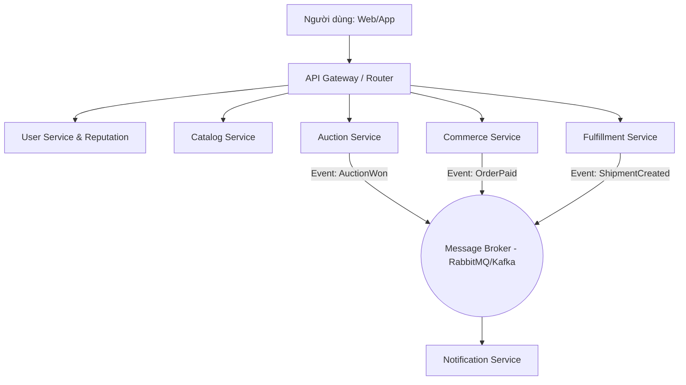
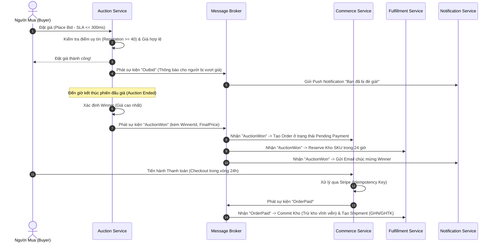

# BẢN PHÂN TÍCH TOÀN DIỆN VÀ HƯỚNG DẪN BẢO VỆ SRS: PROJECT NEXUS (E-COMMERCE & AUCTION MARKETPLACE)

> **Dành cho Sinh viên OJT / Đồ án Kỹ thuật Phần mềm**  
> *Mục tiêu:* Giúp bạn hiểu từ "gốc rễ" đến "ngọn", giải thích siêu dễ hiểu các khái niệm phức tạp, sẵn sàng trả lời bất kỳ câu hỏi nào từ Giảng viên, Mentor hoặc Nhà tuyển dụng.

---

## MỤC LỤC
1. [TỔNG QUAN HỆ THỐNG NEXUS VÀ BÀI TOÁN KINH DOANH](#1-tổng-quan-hệ-thống-nexus-và-bài-toán-kinh-doanh)
2. [TỪ ĐỔI KHÁI NIỆM KỸ THUẬT: GIẢI THÍCH NHƯ CHO NGƯỜI MỚI BẮT ĐẦU](#2-từ-điển-khái-niệm-kỹ-thuật-giải-thích-như-cho-người-mới-bắt-đầu)
3. [PHÂN TÍCH CHI TIẾT 6 MICROSERVICES TRONG HỆ THỐNG](#3-phân-tích-chi-tiết-6-microservices-trong-hệ-thống)
   - [3.1 User Service & Reputation (Người dùng & Uy tín)](#31-user-service--reputation-người-dùng--uy-tín)
   - [3.2 Catalog Service (Sản phẩm & Danh mục)](#32-catalog-service-sản-phẩm--danh-mục)
   - [3.3 Commerce Service (Giỏ hàng, Thanh toán & Đơn hàng)](#33-commerce-service-giỏ-hàng-thanh-toán--đơn-hàng)
   - [3.4 Auction Service (Đấu giá trực tuyến)](#34-auction-service-đấu-giá-trực-tuyến)
   - [3.5 Fulfillment Service (Tồn kho SKU & Vận chuyển Logistics)](#35-fulfillment-service-tồn-kho-sku--vận-chuyển-logistics)
   - [3.6 Notification & Event Logging Service (Thông báo & Nhật ký hệ thống)](#36-notification--event-logging-service-thông-báo--nhật-ký-hệ-thống)
4. [QUY TRÌNH LUỒNG DỮ LIỆU ĐIỂN HÌNH (BUSINESS FLOWS)](#4-quy-trình-luồng-dữ-liệu-điển-hình-business-flows)
5. [BỘ CÂU HỎI HỎI - ĐÁP THEO TỪNG PHẦN (CƠ BẢN & ÔN TẬP SRS)](#5-bộ-câu-hỏi-hỏi---đáp-theo-từng-phần-cơ-bản--ôn-tập-srs)
6. [BỘ CÂU HỎI MỞ RỘNG & ĐÀO SÂU KỸ THUẬT (DÀNH CHO ĐIỂM 9-10 & PHỎNG VẤN)](#6-bộ-câu-hỏi-mở-rộng--đào-sâu-kỹ-thuật-dành-cho-điểm-9-10--phỏng-vấn)

---

## 1. TỔNG QUAN HỆ THỐNG NEXUS VÀ BÀI TOÁN KINH DOANH

### 1.1 Project Nexus là gì?
Project Nexus là một **Sàn thương mại điện tử kết hợp Đấu giá trực tuyến (E-commerce Marketplace & Online Auction)** kết nối giữa người bán (Seller) và người mua (Buyer).

Nói một cách dân dã:  
- Nó giống như sự kết hợp giữa **Shopee/Tiki** (mua bán hàng bình thường) và **eBay** (đấu giá sản phẩm độc lạ, đồ cổ, điện thoại hot).
- Hệ thống hỗ trợ đa người dùng: Người mua (Buyer), Người bán (Seller), Nhân viên hỗ trợ (Support Staff), Quản trị viên (Admin).

### 1.2 Kiến trúc tổng thể: Microservices
Thay vì viết toàn bộ phần mềm vào **1 file/1 dự án khổng lồ (Monolith - Khối bê tông)**, Project Nexus được tách thành **6 dịch vụ nhỏ riêng biệt (Microservices)**:
1. `User Service`: Quản lý tài khoản, phân quyền, điểm uy tín.
2. `Catalog Service`: Quản lý danh mục, danh sách sản phẩm, tìm kiếm.
3. `Commerce Service`: Quản lý giỏ hàng, thanh toán, đơn hàng.
4. `Auction Service`: Quản lý các phiên đấu giá, nhận giá đặt (Bid), chốt người thắng.
5. `Fulfillment Service`: Quản lý kho hàng theo mã SKU, giữ hàng (reserve) và kết nối đơn vị vận chuyển (GHN, GHTK).
6. `Notification Service`: Gửi Email/Push notification và ghi log sự kiện hệ thống.

---

## 2. TỪ ĐIỂN KHÁI NIỆM KỸ THUẬT: GIẢI THÍCH NHƯ CHO NGƯỜI MỚI BẮT ĐẦU

Để không bị bỡ ngỡ khi đọc tài liệuSRS hoặc trả lời câu hỏi của thầy cô, hãy ghi nhớ các ví dụ thực tế này:

| Khái niệm SRS | Giải thích cực kỳ đơn giản | Ví dụ thực tế dễ hiểu |
| :--- | :--- | :--- |
| **Microservices** | Mỗi đội làm một việc riêng, nhà bếp riêng, không chung chảo. | Như một nhà hàng có: 1 người giữ xe, 1 người thu ngân, 1 bếp trưởng, 1 người giao hàng. Người này nghỉ không làm chết cả nhà hàng. |
| **Bounded Context (Ranh giới nghiệp vụ)** | Mỗi Service chỉ quản lý đúng dữ liệu của nó, không thò tay sang cơ sở dữ liệu của dịch vụ khác. | User Service không được tự tiện chui vào database của Commerce Service để sửa giá tiền. Phải gọi API xin phép! |
| **Database per Service** | Mỗi dịch vụ có 1 cuốn sổ tay (Database) riêng. | Bếp có sổ nhập nguyên liệu, Thu ngân có sổ tiền tệ. Thu ngân không mở sổ bếp ra viết đè lên. |
| **Idempotency (Tính bất biến / Trùng lặp)** | Bấm 1 lần hay bấm 100 lần thì kết quả và số tiền bị trừ vẫn chỉ là 1 lần duy nhất. | Bạn bấm nút "Thanh toán 1 triệu" 10 lần liên tục do mạng lag. Nhờ Idempotency, tài khoản bạn chỉ bị trừ đúng 1 triệu, không bị trừ 100 triệu. |
| **Anti-Sniping (Chống tỉa giá phút chót)** | Tự động gia hạn thời gian đấu giá nếu có người nhảy vào đặt giá ở những giây cuối cùng. | Đấu giá còn 2 giây cuối, có người đặt giá cao hơn -> Hệ thống tự gia hạn thêm 5 phút để mọi người cùng công bằng gia tăng giá tiếp. |
| **SKU (Stock Keeping Unit)** | Mã phân loại sản phẩm chi tiết theo thuộc tính (Màu sắc, Kích cỡ, Dung lượng). | Không gọi chung là "Áo thun", mà là `AT-DO-L` (Áo thun - Màu đỏ - Size L). |
| **Inventory Reservation (Giữ hàng tồn kho)** | Tạm khóa món hàng lại trong vài phút để chờ bạn trả tiền. | Bạn cho áo vào giỏ và bấm thanh toán. Hệ thống tạm giữ cái áo đó 15 phút. Nếu sau 15 phút bạn không trả tiền, cái áo tự trả về kệ cho người khác mua. |
| **Adapter Pattern (Mẫu thích ứng vận chuyển)** | Đầu cắm chuyển đổi đa năng để dùng với nhiều đơn vị giao hàng khác nhau mà không đổi code lõi. | Giống như cục adapter sạc máy tính. Dù ổ điện GHN hay GHTK tròn hay dẹt, cắm qua Adapter là xài tốt. |
| **Event-Driven Architecture (Kiến trúc theo sự kiện)** | Làm xong việc thì hò lên một tiếng (phát sự kiện), ai quan tâm thì tự nghe và làm tiếp việc của mình. | Đơn hàng thanh toán xong -> Phát sự kiện `OrderPaid`. Notification Service nghe thấy -> Tự động gửi Email cho khách. |
| **Circuit Breaker (Cầu dao điện kỹ thuật số)** | Tự động ngắt kết nối khi một dịch vụ bên ngoài bị sập, tránh gây treo toàn bộ hệ thống. | Khi GHN bị sập web, cầu dao ngắt luôn, không bắt khách hàng chờ xoay vòng 30 giây nữa, mà báo ngay "Dịch vụ giao hàng tạm gián đoạn". |
| **SLA (Service Level Agreement)** | Cam kết thời gian phản hồi hoặc độ hoạt động ổn định. | Cam kết đặt giá đấu giá phải xong trong ≤ 300 ms (0.3 giây). |
| **RTO & RPO** | **RTO:** Thời gian tối đa để khôi phục khi sập (≤ 4 tiếng).  **RPO:** Dữ liệu tối đa chấp nhận bị mất (≤ 15 phút). | Sập server lúc 12h: Phải sửa xong trước 16h (RTO). Dữ liệu bị mất tối đa là các giao dịch từ 11h45 đến 12h00 (RPO). |

---

## 3. PHÂN TÍCH CHI TIẾT 6 MICROSERVICES TRONG HỆ THỐNG

### 3.1 User Service & Reputation (Người dùng & Uy tín)
- **Nhiệm vụ chính:**
  - Đăng ký, Đăng nhập (Authentication via OAuth2/JWT), Quên mật khẩu.
  - Quản lý thông tin người dùng (Buyer, Seller, Admin, Support Staff).
  - Quản lý Phân quyền theo Vai trò (RBAC - Role-Based Access Control) & Privileges list.
  - **Hệ thống Điểm uy tín (Reputation Score) & Mức độ tin cậy (Trust Level):**
    - Đánh giá 5 sao sau giao dịch.
    - Cộng/Trừ điểm dựa trên hành vi (VD: Đấu giá thắng nhưng không trả tiền -> Bị trừ 10 điểm uy tín).
    - Giới hạn quyền: Cần tối thiểu **40 điểm uy tín** mới được Đặt giá đấu giá (`MIN_REPUTATION_TO_BID = 40`), **50 điểm** mới được Tạo phiên đấu giá (`MIN_REPUTATION_TO_SELL = 50`).

### 3.2 Catalog Service (Sản phẩm & Danh mục)
- **Nhiệm vụ chính:**
  - Quản lý Danh mục (Categories) theo cấp cây (Tối đa 3 cấp hierarchy: `CATEGORY_MAX_LEVEL = 3`).
  - Quản lý Sản phẩm (Products): Tạo, Sửa, Xóa mềm (Soft delete), Upload tối đa 5 hình ảnh (`MAX_PRODUCT_IMAGES = 5`).
  - Tìm kiếm & Lọc (Search & Discovery): Tìm theo tên, giá, danh mục, gợi ý sản phẩm hot/đang đấu giá.

### 3.3 Commerce Service (Giỏ hàng, Thanh toán & Đơn hàng)
- **Nhiệm vụ chính:**
  - **Giỏ hàng (Shopping Cart):** Mua hàng thường. Mỗi user có tối đa 1 giỏ hàng active. Giỏ hàng hết hạn sau 7 ngày. Cho phép khách vô danh (Guest) tạo giỏ hàng, khi đăng nhập sẽ tự gộp giỏ hàng (`CART_MERGE_ON_LOGIN = true`).
  - **Thanh toán (Checkout & Payment):** Tính lại giá trước khi bấm thanh toán (tránh đổi giá ngầm). Kết nối cổng thanh toán (Stripe). Có thời gian chờ thanh toán (Checkout timeout = 15 phút).
  - **Tạo & Quản lý Đơn hàng (Order Management):** Tạo đơn từ Giỏ hàng HOẶC từ Kết quả Đấu giá (Auction Settlement). Quản lý trạng thái đơn: `Created` -> `Paid` -> `Shipping` -> `Completed` / `Cancelled` -> `Refunded`.
  - **Cơ chế Idempotency:** Nhận webhook thanh toán 5 lần từ Stripe thì chỉ xử lý đúng 1 lần duy nhất (`PAYMENT_IDEMPOTENCY_WINDOW_MINUTES = 60`).

### 3.4 Auction Service (Đấu giá trực tuyến)
- **Nhiệm vụ chính:**
  - **Tạo & Cấu hình Phiên đấu giá:** Giá khởi điểm, Bước giá (`DEFAULT_BID_INCREMENT = 10`), Thời gian bắt đầu/kết thúc (từ 60 phút đến 168 giờ).
  - **Đặt giá (Bidding):** Xử lý đặt giá siêu nhanh (SLA ≤ 300ms, chịu tải ≥ 3,000 bids/phút). Đảm bảo tính nguyên tử (Atomic operation) - không cho 2 người đặt cùng 1 mức giá ở cùng 1 miligiây.
  - **Anti-Sniping (Chống tỉa phút chót):** Nếu có ai đặt giá trong 5 phút cuối (`ANTI_SNIPING_EXTENSION_MINUTES = 5`), tự động lùi thời gian kết thúc thêm 5 phút.
  - **Kết thúc & Chốt kết quả (Auction Settlement):**
    - Chọn người đặt giá cao nhất làm Winner.
    - Phát sự kiện `AuctionWon`. Hạn chót trả tiền là 24 giờ (`AUCTION_PAYMENT_DEADLINE_HOURS = 24`).
    - Nếu Winner không trả tiền -> Phát sự kiện `AuctionPaymentTimeout`, phạt trừ điểm uy tín (10 điểm).

### 3.5 Fulfillment Service (Tồn kho SKU & Vận chuyển Logistics)
- **Nhiệm vụ chính:**
  - **Quản lý Tồn kho cấp SKU (SKU-level Inventory):** Quản lý số lượng tồn kho theo SKU và theo Kho (Warehouse).
  - **Giữ hàng (Inventory Reservation):** Tạm khóa kho khi người dùng đang Checkout hoặc khi thắng đấu giá. Thời gian giữ kho 30 phút (`INVENTORY_RESERVATION_TIMEOUT_MINUTES = 30`). Hết hạn mà không trả tiền -> Tự giải phóng kho về lại kệ hàng (`ALLOW_OVERSELL = false`).
  - **Vận chuyển & Giao hàng (Shipping & Logistics):**
    - Sử dụng mô hình **Adapter Pattern** kết nối nhiều bên giao hàng (GHN, GHTK).
    - Lấy báo giá phí ship (Shipping Quote), Tạo đơn giao hàng (Shipment), Theo dõi mã vận đơn (Tracking).
    - Áp dụng Cầu dao điện (**Circuit Breaker**) & **Retry policy** (thử lại 3 lần) khi API nhà vận chuyển bị chậm hoặc lỗi (`SHIPPING_API_TIMEOUT_MS = 3000ms`).

### 3.6 Notification & Event Logging Service (Thông báo & Nhật ký hệ thống)
- **Nhiệm vụ chính:**
  - **Nhật ký sự kiện (Event Logs):** Tự động hứng mọi Event Message từ Message Broker (UserRegistered, OrderPaid, AuctionWon, InventoryReserved...) và lưu vào DB audit.
  - **Health Check Message Broker:** Tự động kiểm tra sống/chết của RabbitMQ/Kafka theo chu kỳ.
  - **Gửi thông báo (Notifications):** Gửi Email (giao dịch, hóa đơn) và Push Notification (khi bị đè giá Outbid, khi thắng đấu giá). Cho phép người dùng bật/tắt preference thông báo (trừ thông báo thanh toán bắt buộc).

---

## 4. QUY TRÌNH LUỒNG DỮ LIỆU ĐIỂN HÌNH (BUSINESS FLOWS)

### Luồng Đấu Giá & Thanh Toán Đấu Giá (Auction to Order Flow)

---

## 5. BỘ CÂU HỎI HỎI - ĐÁP THEO TỪNG PHẦN (CƠ BẢN & ÔN TẬP SRS)

Dưới đây là những câu hỏi thầy cô hội đồng hoặc Mentor hay hỏi nhất khi duyệt SRS:

### Phần 1: Tổng quan & Phân quyền
- **Q1: Tại sao hệ thống lại chia thành 6 Microservices mà không viết chung 1 dự án cho nhanh?**
  - *Trả lời:* Vì bài toán đấu giá có đặc thù tải rất cao vào giây cuối (hàng ngàn lượt đặt giá/phút). Tách Microservices giúp dịch vụ `Auction Service` có thể nhân bản (scale) độc lập mà không ảnh hưởng đến các dịch vụ khác như `User` hay `Notification`. Ngoài ra giúp các đội dev làm việc độc lập mà không đè code lên nhau.
- **Q2: Phân biệt sự khác nhau giữa Buyer, Seller, Admin và Support Staff trong Privileges Table?**
  - *Trả lời:*
    - **Buyer:** Tìm sản phẩm, giỏ hàng, đặt hàng, đặt giá đấu giá, đánh giá.
    - **Seller:** Đăng bán sản phẩm, tạo phiên đấu giá, xem đơn hàng của mình.
    - **Admin:** Cấu hình hệ thống, quản lý user, duyệt/hủy cưỡng chế đấu giá (Admin force cancel), xem log audit.
    - **Support Staff:** Xem thông tin user/order để giải quyết khiếu nại, tranh chấp (Dispute).

### Phần 2: Đấu giá & Anti-Sniping
- **Q3: Chức năng Anti-Sniping hoạt động thế nào và giải quyết bài toán kinh doanh gì?**
  - *Trả lời:* Anti-Sniping bảo vệ người bán và tính công bằng. Nếu không có nó, các "auto-bot" hoặc người dùng sẽ canh đúng 1 giây cuối cùng để bấm mua với giá rẻ. Khi bật Anti-Sniping, nếu có bid mới trong 5 phút cuối (`ANTI_SNIPING_EXTENSION_MINUTES = 5`), hệ thống tự động cộng thêm 5 phút vào thời gian kết thúc, giúp các bên khác có cơ hội trả giá tiếp, mang lại giá trị cao nhất cho mặt hàng.
- **Q4: Chuyện gì xảy ra nếu người thắng đấu giá (Winner) cố tình không trả tiền?**
  - *Trả lời:* Trong vòng 24h (`AUCTION_PAYMENT_DEADLINE_HOURS`), nếu Winner không thanh toán:
    1. Hệ thống phát sự kiện `AuctionPaymentTimeout`.
    2. Tự động trừ 10 điểm uy tín của Winner (`PAYMENT_TIMEOUT_PENALTY_SCORE = 10`). Điểm xuống thấp sẽ bị cấm đấu giá/bán hàng.
    3. Kho hàng tạm giữ (Reserved Inventory) sẽ được tự động giải phóng (Release) về kho.

### Phần 3: Kho hàng & Vận chuyển (Fulfillment)
- **Q5: Tại sao hệ thống lại quản lý tồn kho theo SKU mà không quản lý theo Product?**
  - *Trả lời:* Vì 1 Sản phẩm (Product) có thể có nhiều biến thể (VD: iPhone 15 có các phiên bản 128GB, 256GB, Màu Đen, Màu Trắng). Mỗi biến thể có giá và số lượng tồn kho khác nhau. Quản lý cấp SKU (`SKU-level Inventory`) mới đảm bảo chính xác kho thực tế.
- **Q6: Giải thích cơ chế Adapter Pattern trong Shipping Service?**
  - *Trả lời:* Adapter đóng vai trò là "lớp trung gian chuyển đổi". Code lõi của hệ thống chỉ giao tiếp với 1 Interface chuẩn (`IShippingCarrier`). Khi muốn tích hợp thêm GHN, GHTK hay ViettelPost, ta chỉ cần viết thêm `GhnAdapter`, `GhtkAdapter` hiện thực Interface đó mà không cần sửa 1 dòng code nào trong nghiệp vụ tạo đơn hàng.

---

## 6. BỘ CÂU HỎI MỞ RỘNG & ĐÀO SÂU KỸ THUẬT (DÀNH CHO ĐIỂM 9-10 & PHỎNG VẤN)

Đây là những câu hỏi mức độ Senior/Architect dùng để thử thách tư duy thiết kế hệ thống của bạn:

### 🔴 Câu 1 (Concurrency Control): Có 10,000 người cùng bấm Đặt giá (Bid) vào giây cuối cùng của phiên đấu giá. Làm sao hệ thống xử lý mà không bị nghẽn (Race condition / Deadlock / Trùng giá)?
- **Trả lời đào sâu:**
  1. **Không ghi thẳng vào SQL Database (RDBMS):** Nếu 10,000 request cùng `UPDATE auctions SET current_price = ...` trong MySQL/Postgres, Database sẽ bị khóa dòng (row locking) và đơ ngay lập tức.
  2. **Giải pháp In-Memory Cache (Redis + Lua Script):** 
     - Mọi lượt Bid sẽ được gửi vào **Redis**. 
     - Dùng **Lua Script** chạy nguyên tử (Atomic execution) trong Redis để so sánh: `If (new_bid > current_bid + increment) { update current_bid; return SUCCESS; } else { return FAIL; }`. Vì Redis đơn luồng (single-threaded) khi thực thi Lua script, chắc chắn không bao giờ có 2 bid cùng thắng ở 1 mức giá.
  3. **Xử lý bất đồng bộ (Asynchronous Persistence):** Sau khi Redis chấp nhận Bid hợp lệ, đẩy 1 sự kiện `BidPlaced` vào Message Broker (RabbitMQ/Kafka) để worker bên dưới tự lưu vết vào Database chính sau.
  4. **Optimistic Locking (Khóa lạc quan):** Ở DB chính, dùng cột `version` để tránh đè dữ liệu.

### 🔴 Câu 2 (Distributed Transaction): Đơn hàng cần gọi qua Commerce Service, Fulfillment Service và Payment Gateway. Vì không dùng chung Database, làm sao đảm bảo tính toàn vẹn dữ liệu nếu Payment thành công nhưng Fulfillment giữ kho bị lỗi?
- **Trả lời đào sâu:**
  - Áp dụng mẫu thiết kế **Saga Pattern (Choreography Saga hoặc Orchestrator Saga)**:
    1. **Bước 1:** Commerce Service tạo Đơn hàng trạng thái `PENDING`.
    2. **Bước 2:** Fulfillment Service nhận sự kiện -> Thực hiện **Reserve Kho**. 
    3. **Bước 3 (Nếu thất bại):** Nếu Kho không đủ, Fulfillment phát sự kiện `InventoryReservationFailed`. Commerce Service nghe thấy sự kiện này sẽ tự động chạy giao dịch bù đắp (**Compensating Transaction**): Chuyển đơn hàng sang `CANCELLED` và tự động kích hoạt Refund lại tiền trên Payment Gateway cho khách!

### 🔴 Câu 3 (Idempotency): Làm sao triển khai Idempotency Key kỹ thuật số cho thanh toán Stripe / Webhook để chống trừ tiền 2 lần?
- **Trả lời đào sâu:**
  - **Cơ chế Idempotency Window (60 phút trong SRS):**
    1. Mỗi request thanh toán/webhook từ Stripe gửi sang đều kèm một header `Idempotency-Key` (ví dụ: `UUID_ORDER_12345`).
    2. Khi Commerce Service nhận request: 
       - Kiểm tra trong Redis/DB xem key `UUID_ORDER_12345` đã tồn tại chưa (`SETNX key value EX 3600`).
       - **Nếu chưa có:** Tiến hành xử lý thanh toán -> Lưu trạng thái `SUCCESS` cùng key này vào Redis trong 60 phút.
       - **Nếu đã có (Duplicate request do Stripe gửi lại khi mạng chập chờn):** Bỏ qua không xử lý lại logic trừ tiền/tạo hóa đơn, trả về ngay lập tức kết quả HTTP 200 kèm Response đã lưu từ lần xử lý trước.

### 🔴 Câu 4 (Database Isolation): SRS quy định "Services are not allowed to access databases owned by other services". Vậy khi Commerce Service hiển thị tên sản phẩm và ảnh sản phẩm trong trang Đơn hàng, nó lấy dữ liệu từ Catalog Service như thế nào cho hiệu quả?
- **Trả lời đào sâu:**
  - Có 2 hướng tiếp cận chuẩn microservices:
    1. **Data Replication / Read Snapshot (Khuyên dùng cho E-commerce):** Khi tạo đơn hàng (Order Creation), Commerce Service sẽ lưu thẳng một bản **Snapshot** (Chụp ảnh dữ liệu tại thời điểm đó: `product_name`, `unit_price`, `product_image`) vào cơ sở dữ liệu của Commerce Service.  
       *Lý do:* Tên và giá sản phẩm trong quá khứ không được phép thay đổi dù sang ngày mai Seller có sửa giá ở Catalog Service.
    2. **API Call via API Gateway / gRPC:** Nếu cần thông tin realtime (VD: trạng thái xem sản phẩm còn bán không), Commerce Service sẽ gọi qua gRPC/REST API công khai của Catalog Service chứ không bao giờ query trực tiếp vào DB của Catalog.

---

## SUMMARIES VÀ LỜI KHUYÊN KHI BẢO VỆ OJT
- Nắm chắc các chỉ số SLA trong SRS (Ví dụ: SLA Đặt giá Bid $\le$ 300ms, Login $\le$ 500ms, RTO $\le$ 4h, RPO $\le$ 15 phút).
- Thuộc lòng 6 tên Microservices và trách nhiệm chính của từng dịch vụ.
- Luôn tự tin khẳng định: *"Dự án thiết kế chuẩn Domain-Driven Design (DDD) & Event-Driven Architecture (EDA) giúp hệ thống mở rộng linh hoạt và không bao giờ bị nghẽn điểm (Single Point of Failure)"*.
